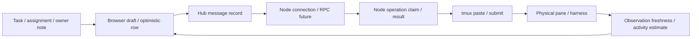

# Implicit state machines in Buzz

Audited source snapshot: **`28ebf3c`**. This is an inventory and transition audit, not a refactor.

**56 state-machine families:** 27 in the hub/node/CLI, 23 in the dashboard, 4 in the Mac app, and 2 operational workflows. The most consequential machines are delivery/replay, identity and pane binding, remote connection fencing, observed activity, task mutation, and chat polling/draft/history coordination. Two transition defects and one restart-policy mismatch were reproduced in isolation; see [verified findings](#verified-findings).

Here, a state machine means retained information that changes which event or operation may happen next. Some names are already explicit (`pending`, `unknown`, `open`); their transition rules still live across functions, database fields, timers and error paths. Other machines have no enum at all: booleans, optional values, cursors, DOM state and promise queues encode them. A family groups parallel sub-machines or repeated instances; this is not a count of booleans or a claim of a mathematically minimal automaton.

Scope: authored Python runtime, dashboard JavaScript/CSS interactions, Mac Rust/setup JavaScript/Objective-C bridge, startup hooks and installation/scheduler entry points. Generated bundles, vendored dependencies, harness internals, demos and test fixtures are not additional app machines. Ordinary filters, string formatting, static configuration values and request authorization predicates are not counted independently unless they take part in a retained workflow. The source coverage ledger below makes the grouping/exclusions reviewable.

## The important distinction: there is no single “agent state”

| Axis | Representation | Why it cannot stand in for the others |
|---|---|---|
| Registered identity | handle, session id, node, pane id, tmux server, reservation | A stopped agent can retain identity, history and tasks. |
| Reachability | node admission/freshness + pane/server checks | Network loss or a failed observation can make an agent unavailable without proving its process exited. |
| Activity estimate | working / idle / needs_attention / unknown / stopped, plus clocks/hash | Changed output is a heuristic; failed capture is unknown, not proof of idleness. |
| Work record | task status/owner/dependencies and status/owner notes | Updating a task or note does not start, stop or inspect a harness. |
| Delivery knowledge | pending / delivered / failed / unknown + client/operation id | Unknown is a statement about evidence, not permission to retry a side effect. |
| Browser knowledge | snapshot age, detail history, optimistic pending rows, read cursors | A local placeholder is not a durable hub message; a successful old response is still old. |



A response can be lost after the paste succeeded. A registration can survive a reboot while its pane cannot. A modal, focused chat, compact layout and a hidden sidebar are also separate axes, not a single open/closed page state. Preserve these distinctions when making any machine explicit.

## Inventory

The state/transition descriptions below summarize current behavior, not proposed restrictions. Evidence links point at the audited source lines; symbols are included because line numbers will move. Existing tests named later exercise representative parts, not every possible transition in every family.

### Hub, node, persistence, and CLI — 27 families

| ID | Machine | Current states, events and guards | Implementation evidence |
|---|---|---|---|
| S01 | **Agent registration and rebinding** | New handle / existing session / existing pane / restored label / requested rename → registered. Name collision, node ownership and reservation checks gate writes. Renames carry history, tasks and roles; registration preserves omitted metadata. | [def register(](../agent_swarm/server.py#L1038); [def rename_recipient(](../agent_swarm/db.py#L247) |
| S02 | **Caller identity and session adoption** | Known session → identified without pane lookup. Unknown session + verified pane with no session → adopt; a new session in the same process tree and harness can replace the old one. Missing proof, another node or a conflicting session → refused. This is distinct from registration. | [def _resolve_caller(](../agent_swarm/server.py#L833); [def adopt_agent_id(](../agent_swarm/db.py#L436) |
| S03 | **Recipient availability** | Registered does not mean reachable. Reservation, missing/disconnected node, unobservable node, changed tmux server, missing pane, bare shell, live harness and trust prompt are separate conditions. `_offline`/`_reach` gate dispatch; UI derives `stopped` from `pane_alive`. | [def _offline(](../agent_swarm/server.py#L1228); [def _reach(](../agent_swarm/server.py#L1300); [function agentStatus(](../web/src/shared.js#L59) |
| S04 | **Imported reservation and legacy pane binding** | Unbound imported handle → reserved → claimed by its permitted session. Old positional pane references → matched by title/harness/freshness or left offline; conflicting claims choose stronger evidence. Re-registering clears the reservation. | [def plan(](../agent_swarm/panes.py#L41); [def _migrate_legacy_panes(](../agent_swarm/server.py#L1276); [def clear_reservation(](../agent_swarm/db.py#L1259) |
| S05 | **Message delivery and client-id replay** | Not recorded → pending → delivered / failed / unknown. Hub startup turns abandoned pending rows into unknown. Same owner client id replays the recorded outcome; failure releases that id. Unknown delivery is not automatically executed again. `delivered` legacy flag is a projection, not another independent outcome. The owner-reply reminder separately becomes due after registration or conversation inactivity and resets from confirmed delivery history. | [def _dispatch(](../agent_swarm/server.py#L1472); [def _replayed(](../agent_swarm/server.py#L1465); [def abandon_pending_messages(](../agent_swarm/db.py#L972); [def set_message_status(](../agent_swarm/db.py#L1001); [def owner_reply_reminder_due(](../agent_swarm/db.py#L952) |
| S06 | **Paste and submit handshake** | Buffer loaded → paste attempted → text may have reached pane → submit attempted → optional one-key retry. Definite pre-paste refusals are failed; timeouts after a possible paste are uncertain. Retry only the submit key, not the text. Menu-opening terminal input disables the submit retry. | [def deliver(](../agent_swarm/tmux.py#L287); [def _await_submit(](../agent_swarm/tmux.py#L241) |
| S07 | **Durable node operation journal** | Absent → in_flight → done(result). Duplicate fingerprint replays; conflicting fingerprint refuses; still-in-flight duplicate returns unknown. A daemon restart settles abandoned claims as unknown. A command proven not executed releases its claim. Pruning bounds the replay horizon. | [class OpStore:](../agent_swarm/node.py#L68); [class Executor:](../agent_swarm/node.py#L223) |
| S08 | **Node enrolment and connection admission** | No token → enrolled token → authenticated hello → admitted connection. Rotation/revocation disconnects the current node. Admission rechecks the token after hello; a newer connection fences the previous instance. HTTP principal checks are guards here, not a separate persistent session. | [async def nodes_ws(](../agent_swarm/server.py#L2137); [def nodes_token(](../agent_swarm/server.py#L2284); [def _disconnect(](../agent_swarm/server.py#L966) |
| S09 | **Hub-side remote RPC and fencing** | Queued future → frame sent → result / timeout / disconnect. A fence is terminal for a RemoteNode instance and resolves pending work unknown. A queued send rechecks that it is still owned before sending. Local result certainty maps to message outcome, not HTTP success alone. | [class RemoteNode:](../agent_swarm/nodes.py#L356); [def _call(](../agent_swarm/nodes.py#L485) |
| S10 | **Node daemon session, queue and reconnect** | Dial → hello/welcome → observing + reading + command workers → ended → backoff → new session. Per-pane queues serialize operations; TTL includes waiting. The local session-ended token prevents old queued commands from executing after reconnect, regardless of reused hub generations. | [class Daemon:](../agent_swarm/node.py#L366); [async def session(](../agent_swarm/node.py#L437); [async def run_forever(](../agent_swarm/node.py#L526) |
| S11 | **Observation freshness and watch lists** | Unobserved → fresh observation → stale/unavailable; a new observation refreshes it. Hub watch changes alter the next capture set. Pane-server mismatch suppresses captures. Remote snapshots are cached observations, not a new synchronous view of physical tmux every time. | [def observed(](../agent_swarm/nodes.py#L407); [class RemoteNode:](../agent_swarm/nodes.py#L356); [def _set_watch(](../agent_swarm/node.py#L418) |
| S12 | **Activity classifier** | stopped / unknown / working / idle / needs_attention, derived from pane visibility, capture success, snapshot hash and elapsed time. Changing output means working; unchanged output must settle for two intervals before prompt classification. `since` and `changed_at` are separate clocks. | [def step(](../agent_swarm/activity.py#L138) |
| S13 | **Attention notification latch** | Entering needs_attention resets `notified`; the grace threshold emits once and latches it. Leaving attention resets the latch. Missing observations remove registry rows. The hub records an owner message; the native app has its own independent attention-entry notification machine. | [def step(](../agent_swarm/activity.py#L138); [async def _monitor_tick(](../agent_swarm/server.py#L642) |
| S14 | **Supervisor appointment and digest cursor** | Absent → appointed/replaced → cleared or removed with registration. Interval elapsed + supervisor alive + other traffic/task changes → nudge. Cursor/time advance even without a nudge; a lost/unknown notification is not replayed. Supervisor identity, eligibility and nudge schedule are independent axes. | [def _nudge_supervisor(](../agent_swarm/server.py#L620); [def supervisor_set(](../agent_swarm/server.py#L2068); [def set_supervisor_cursor(](../agent_swarm/db.py#L526) |
| S15 | **Task status and verification** | open / picked_up / done, with an optional persisted verification note. The API accepts valid status values rather than enforcing a sequential transition matrix. Closing requires an existing or supplied note. UI reopening chooses picked_up when owned and open otherwise; Start work is UI-gated on assignment. | [def tasks_update(](../agent_swarm/server.py#L1813); [def update_task(](../agent_swarm/db.py#L709); [function TaskStatusActions(](../web/src/task-status.js#L7) |
| S16 | **Task ownership, dependencies and assignment notification** | Unassigned / individual / team are exclusive owners; setting one clears the other. Dependencies are acyclic and point to known tasks; incomplete dependencies produce a derived blocked presentation, not a stored status. Changed owner triggers a notification after storage. Notification failure does not undo assignment. | [def update_task(](../agent_swarm/db.py#L709); [def set_task_deps(](../agent_swarm/db.py#L677); [def _notify_assignment(](../agent_swarm/server.py#L1707); [def _notify_team_assignment(](../agent_swarm/server.py#L1727) |
| S17 | **Team membership and queen role** | No team → member → moved/removed; member → queen → replaced/cleared. A queen must be a member; moving the queen out clears the crown. Team deletion clears memberships/associations. Queen assignment and its prompt delivery are separate effects. | [def set_agent_team(](../agent_swarm/db.py#L850); [def update_team(](../agent_swarm/db.py#L805); [def delete_team(](../agent_swarm/db.py#L829); [def teams_update(](../agent_swarm/server.py#L2009) |
| S18 | **Spawn lifecycle** | Validated harness/model/folder → window requested → no window with failed/unknown outcome, or known pane → registered/tagged → launch ok/unknown. A known window is not proof the harness is ready. The browser distinguishes uncertain creation from a registered pane whose launch is unknown. | [def agents_spawn(](../agent_swarm/server.py#L1862); [def spawn_window(](../agent_swarm/tmux.py#L517); [function spawnOutcome(](../web/src/outcome.js#L70) |
| S19 | **Stop, retire, prune and unregister** | Stop checks node observation, treats stale/gone/shell as already stopped, otherwise kills while retaining the registration/history. Retire/prune may delete offline registrations; unregister deliberately removes a registration. These are not interchangeable transitions to a single deleted state. | [def agents_stop(](../agent_swarm/server.py#L1918); [def retire_recipients(](../agent_swarm/server.py#L1386); [def prune_recipients(](../agent_swarm/server.py#L1354); [def delete_recipient(](../agent_swarm/db.py#L479) |
| S20 | **Terminal command interaction** | Exactly one of text or key → availability check → deliver/send_key → ok / failed / unknown. A text command may open a harness menu, then individual key events navigate it. No message row or envelope is created; trust prompts can be answered here instead of by ordinary message injection. | [def agents_terminal(](../agent_swarm/server.py#L1958); [def send_key(](../agent_swarm/tmux.py#L768) |
| S21 | **Agent status history and owner annotation** | Agent/title status changes deduplicate by source and retain bounded history. Owner note absent/set/edited/cleared is a separate persistent field; owner changes also append history entries. Agent statuses never replace it. Current status selection excludes owner history entries. | [def record_summary(](../agent_swarm/db.py#L544); [def set_owner_note(](../agent_swarm/db.py#L575); [function Doing(](../web/src/main.js#L1387) |
| S22 | **Attachment/message retention** | Uploaded blob → unreferenced draft orphan or referenced message/task attachment → eligible for cleanup → gone. Message deletion can orphan its files; task references keep files alive. Cache files and operation results have separate retention schedules. Retention can remove a reply parent without removing its reply. | [def sweep(](../agent_swarm/attachments.py#L94); [def _cleanup(](../agent_swarm/server.py#L712); [def attachment_last_used(](../agent_swarm/db.py#L1087); [class AttachmentCache:](../agent_swarm/node.py#L161) |
| S23 | **Database upgrades and bundle import** | Old schema → migrated schema; reply suffix conversion happens only when adding reply_to. Bundle read/validate/plan → dry run or one atomic import → receipt; source-id receipt prevents repeat import unless explicitly overridden. Imported message/task IDs and reservations are reconstructed, not resumed processes. | [def _ensure_columns(](../agent_swarm/db.py#L267); [def apply_import(](../agent_swarm/db.py#L1274); [def plan(](../agent_swarm/bundle.py#L279); [def import_bundle(](../agent_swarm/server.py#L2210) |
| S24 | **Snapshot storage and selection** | Capture layout/session identities → unchanged snapshot skipped or temp write → atomic publish → old snapshots pruned. Default selection chooses a prior tmux server; explicit selection can choose another file. A snapshot records resumable identity/layout, not process memory. | [def save(](../agent_swarm/restore.py#L103); [def pick(](../agent_swarm/restore.py#L124); [def cmd_snapshot(](../agent_swarm/client.py#L501) |
| S25 | **Restore planning, execution and readiness** | Plan missing layout / skip existing-running sessions → create session/window/pane → launch → harness running → settle to ok / trust-blocked / failed → register. Failure can block later steps for that window while other windows continue. Trust-blocked still registers, but normal messages are held back. | [def plan(](../agent_swarm/restore.py#L222); [def apply(](../agent_swarm/restore.py#L381); [def startup(](../agent_swarm/restore.py#L345); [def plan_one(](../agent_swarm/restore.py#L504) |
| S26 | **Restart eligibility and self-restart** | Plan → skipped(reason) / eligible → explicit apply → respawn pane → type resume command. Busy working/needs_attention requires force, but unknown activity currently does not. Restarting the caller delegates execution to tmux so killing the caller does not interrupt the sequence. | [BUSY =](../agent_swarm/restart.py#L24); [def plan(](../agent_swarm/restart.py#L40); [def apply(](../agent_swarm/restart.py#L81) |
| S27 | **CLI registration hook and machine join** | Hook disabled/not own TUI/no pane/ambiguous session/hub refusal → quiet skip; valid session → register → inject protocol brief. Pi excludes reload/non-TUI starts and bounds the helper lifetime. Join validates hub/token/node before persisting configuration; later commands read it. Hostname-derived node identity is remembered so a machine rename does not silently change identity. | [def cmd_autoregister(](../agent_swarm/client.py#L385); [function autoregister(](../hooks/pi/agent-swarm/index.ts#L10); [def cmd_join(](../agent_swarm/client.py#L799); [def write(](../agent_swarm/config.py#L125) |

### Dashboard — 23 families

| ID | Machine | Current states, events and guards | Implementation evidence |
|---|---|---|---|
| W01 | **Global polling and connection indicator** | No state + connecting → successful snapshot + connected → later fetch/JSON error + disconnected while retaining old state → recovery. Timer and mutation-triggered refreshes use the same unsequenced poll function; older responses can overwrite newer ones (finding R1). | [const poll = async () =>](../web/src/main.js#L1834) |
| W02 | **Unread/fresh cursors** | First load seeds per-agent seen cursors; later IDs become fresh; viewing an agent advances its cursor. Only new agent-to-owner messages produce unread indicators. Global maxId is monotonic even if the displayed snapshot regresses. State is browser-memory-local, not a persisted read receipt. | [const seen = useRef(](../web/src/main.js#L1805); [const unreadFor =](../web/src/main.js#L1905) |
| W03 | **Draft, optimistic send and delivery reconciliation** | Draft in localStorage → upload gate → cleared composer + pending optimistic row → request. uncertain transport retries the same client id; delivered settles; unknown warns without restoring the draft; failed/continued uncertainty restores it. Global events route the outcome across composer remounts; refresh precedes placeholder removal. | [function MessageComposer(](../web/src/main.js#L925); [const RESEND_DELAYS_MS](../web/src/main.js#L923); [pendingSends.addEventListener("add"](../web/src/main.js#L1810); [function deliveryOutcome(](../web/src/outcome.js#L13); [function draftClientId(](../web/src/outcome.js#L39) |
| W04 | **Upload sessions and attachment display** | Scope active → pending uploads → attached / rejected; scope replacement marks prior session inactive so its results cannot attach to another draft. Pending counts gate Send. Drag hover is orthogonal. Images can separately move from loading/available to unavailable via onError. | [function useAttachments(](../web/src/attachments.js#L10); [function AttachmentLink(](../web/src/attachments.js#L67) |
| W05 | **Per-agent history controller** | Initial load → loaded; newest/oldest cursors support incremental catch-up and older paging. Polling and older-loading have separate exclusion flags. Errors preserve prior data and retry; unmount aborts requests and ignores late merges. This state belongs to the detail view, independently of the global feed. | [function useAgentHistory(](../web/src/agent-history.js#L5) |
| W06 | **Reader scroll intent, anchoring and newest-message dock** | Pinned → user scrolls up → unpinned; reaching bottom pins again. Content growth is not user intent. Older prepends preserve the old viewport anchor; awayFrom records the newest ID when leaving bottom; newer agent messages increment the jump badge; click scrolls to bottom. | [function createBottomFollower(](../web/src/scroll-follow.js#L4); [const previousHistory =](../web/src/main.js#L1146); [const noteAway =](../web/src/main.js#L1274) |
| W07 | **Conversation collapse/focus/viewport and resize** | Collapsed ↔ expanded; expanded ↔ focused full-screen; Escape exits focus. Focus implies expanded and changes root CSS, scroll layout, font scaling and visualViewport listeners. Pointer capture drives history resize start/move/end/cancel. Compact focused mode controls the bottom composer layout. | [function Thread(](../web/src/main.js#L1141); [const toggleFocus =](../web/src/main.js#L1227); [const resizeStart =](../web/src/main.js#L1298) |
| W08 | **Route, sidebar, compact layout and teammate handoff** | Overview / agent / chats / history / extra-tab route; desktop sidebar open/closed persists, compact layout mounts roster elsewhere. Teammate/switcher navigation carries composer focus and conversation focus across remounts. Missing bookmarked agent redirects only during initial state load. | [function App(](../web/src/main.js#L1760); [function useTeammateKeys(](../web/src/main.js#L1437); [function useMedia(](../web/src/use-media.js#L6) |
| W09 | **Quick-switch modal** | Closed → agents/teams mode → search + selection → choose/navigate or cancel → restore prior focus. Arrow keys select available targets; composition/modifier guards govern opening. The DOM dialog.open, mode, selected item and previous active element jointly encode the state. | [function QuickSwitcher(](../web/src/quick-switch.js#L36) |
| W10 | **Confirmation/notice queue and shortcut ownership** | Enqueued → modal shown → confirmed/cancelled → removed + prior focus restored → next modal. Enter/Escape are consumed by the modal. Global shortcuts separately guard dialogs, switchers and focused conversations; priority is spread across capture/bubble listeners rather than one owner. | [function enqueue(](../web/src/dialogs.js#L58); [function openDialog(](../web/src/dialogs.js#L10); [const rosterShortcut =](../web/src/main.js#L1784); [// Consume Escape before page-level shortcuts](../web/src/main.js#L1270) |
| W11 | **Reply selection, lookup and navigation** | No reply target → selected target → cancel/send; returned retry retains its target and affects send identity. A quote resolves from loaded message/preview → fetch original if needed → expanded original or error/retry. Loaded targets scroll/focus/highlight; animation completion removes the highlight. | [const [replyTo, setReplyTo]](../web/src/main.js#L1154); [function ReplyPreview(](../web/src/reply-preview.js#L8); [function draftClientId(](../web/src/outcome.js#L39) |
| W12 | **Terminal view and input** | Closed → open + periodic captures → data/error; close/unmount cancels future state application and interval. Scroll pinning differs from chat. Input text/key → busy → sent/error; shortcut/manual details toggle must agree, and closing returns focus out of the hidden terminal. | [function Scope(](../web/src/main.js#L793); [function TerminalInput(](../web/src/main.js#L876) |
| W13 | **Canvas task/bee/team drag** | Pointer press → below-threshold click or moved drag → bee/team/trash target → assign/move/delete/reposition or cancel. Parallel refs encode task, bee, team-box, point and drop targets; clearDrop resets them. Pointer capture and native task-card drops enter through different event paths. | [const pointerDown =](../web/src/hive.js#L821); [const pointerUp =](../web/src/hive.js#L872); [const clearDrop =](../web/src/hive.js#L741); [const dragOver =](../web/src/hive.js#L923) |
| W14 | **Roster drag, team management and collapse** | No drag → dragged handle + active group/stop zone → drop/move/stop or drag-end reset. Empty groups become drop targets while dragging. Managing a team and persisted expanded/collapsed groups are orthogonal; separate from the canvas gesture machine. | [function TeamBees(](../web/src/main.js#L650); [function agentDropProps(](../web/src/main.js#L332); [function TeamManage(](../web/src/main.js#L604) |
| W15 | **Hive animations and render lifetime** | Initial snapshot seeds last-seen IDs → new-message streak queues; task-done transition queues shipping animation → flying token → shipped. Dance idle → timed figure-eight → return. Reduced-motion switches scheduling; compact mode tears down canvas state and listeners. | [function HiveView(](../web/src/hive.js#L120); [const pendingShipmentsRef =](../web/src/hive.js#L138); [const danceRef =](../web/src/hive.js#L148) |
| W16 | **Task creation draft and uploads** | Persisted/new draft → editing + pending attachments → creating → success clears draft/fields or failure retains them. Scope switches between global and per-agent task creation. Folded form presentation is independent of busy/error/upload state. | [function TaskComposer(](../web/src/main.js#L486) |
| W17 | **Task edit, complete, reopen and trash UI** | Read tile → edit title/description → save/error/cancel. Complete without note opens verification editor; valid note enables update. Reopen derives target status from ownership. Trash adds queued confirmation before delete. Board, history and hive detail share some actions but retain distinct local flags. | [function TaskEdit(](../web/src/history.js#L149); [function TaskStatusActions(](../web/src/task-status.js#L7); [function TaskTrash(](../web/src/task-trash.js#L13); [function TaskCard(](../web/src/main.js#L422); [function HiveTaskDetail(](../web/src/hive.js#L80) |
| W18 | **Owner-note and model editors** | Read → editing draft → saving → read/updated or error/retry; cancel discards the local edit. Model editor additionally loads allowed model choices; the owner-note editor can clear a persisted value. These are small instances of the same mutation family, not the agent activity machine. | [function OwnerNote(](../web/src/owner-note.js#L5); [function ModelLabel(](../web/src/main.js#L177) |
| W19 | **Agent/role mutation controls** | SpawnControl loads capabilities, gates machine/harness/model/folder combinations, submits and distinguishes known/unknown outcomes. Compact, stop, retire and resend pass through confirmation/busy/error/refresh; stop may navigate away from a stopped agent. Team/queen/supervisor controls have save/notify consequences after selection. JumpToPane has a copied acknowledgement that expires after 1.5 seconds, with a copy fallback on error. | [function SpawnControl(](../web/src/main.js#L228); [function CompactButton(](../web/src/main.js#L79); [function StopAgentButton(](../web/src/main.js#L135); [function RetireButton(](../web/src/main.js#L124); [function Resend(](../web/src/main.js#L371); [function JumpToPane(](../web/src/main.js#L55) |
| W20 | **History/chats view loading and disclosures** | Unloaded full-message history → fetched or fallback-empty after error; filtering/search/view state is mirrored in route parameters. Task/status tiles, clipped text, prior status updates and talk bursts expand/collapse separately. Full chat fetches and incremental agent history have different recovery semantics. | [function AgentTalk(](../web/src/main.js#L1532); [function OwnerChats(](../web/src/main.js#L1604); [function HistoryView(](../web/src/history.js#L238); [function Clipped(](../web/src/history.js#L138); [function Doing(](../web/src/main.js#L1387) |
| W21 | **Native attention reporting** | No native bridge → inert. Bridge present: unsent list → sent-key → unchanged list skipped; rejected invocation resets the key for retry on the next poll. This is a browser-to-native acknowledgement machine, independent of whether an OS notification was displayed. | [function attentionReporter(](../web/src/native.js#L15) |
| W22 | **Extra-tab iframe lifecycle** | Known tab → iframe navigation/load → same-origin shortcut listener attached; unknown tab → explanatory empty state. Cross-origin frames cannot be wired. Modified keyboard events are forwarded to the page, which decides whether it owns them. | [function TabView(](../web/src/tabs.js#L18); [function forwardShortcuts(](../web/src/tabs.js#L5) |
| W23 | **Bounded text/aggregation automata** | ANSI parsing carries style across SGR runs and resets it on reset sequences. Chat aggregation folds chronological messages into pair bursts or fan-out broadcasts using time/member boundaries. These are per-computation machines rather than persistent UI lifecycles; Markdown highlighting and newline conversion are otherwise ordinary transformations. | [function parseAnsi(](../web/src/ansi.js#L86); [function apply(](../web/src/ansi.js#L48); [function agentThreads(](../web/src/chats.js#L43) |

### Mac native app — 4 families

| ID | Machine | Current states, events and guards | Implementation evidence |
|---|---|---|---|
| N01 | **Setup, selected hub and privilege boundary** | Missing/invalid settings → local setup → saving → same-hub navigation or changed-hub restart → selected-origin dashboard. The origin capability is fixed for a runtime, so changing hubs restarts instead of accumulating grants. Setup UI disabled/error states and atomic settings persistence participate in this workflow. | [async function initialize(](../mac/setup/setup.js#L13); [fn save_hub(](../mac/src-tauri/src/app.rs#L83); [pub fn save(](../mac/src-tauri/src/lib.rs#L82) |
| N02 | **Window visibility, route restoration and navigation** | Shown ↔ hidden; close request remembers route and hides rather than quits. Tray/single-instance activation shows the window; explicit Quit exits. Selected-origin routes stay in-app and are remembered; other http(s) links open externally; notification action navigates to an agent. | [fn show_dashboard(](../mac/src-tauri/src/app.rs#L153); [fn remember_route(](../mac/src-tauri/src/app.rs#L34); [fn menu_action(](../mac/src-tauri/src/app.rs#L190); [CloseRequested](../mac/src-tauri/src/app.rs#L300) |
| N03 | **Attention set and Dock badge** | Previous validated agent set → diff next set → apply badge → commit tracker → notify added agents. Badge failure keeps the previous tracker so the browser can retry. Leaving and re-entering attention can notify again. An applied list is not rolled back because OS notification delivery failed. | [pub struct Attention](../mac/src-tauri/src/lib.rs#L101); [fn attention(](../mac/src-tauri/src/app.rs#L118) |
| N04 | **Notification authorization, delivery and click** | No bundle / permission denied / authorized govern enqueueing. Permission requests and native delivery are asynchronous; denied enable flow can open System Settings. A notification identifier replaces earlier notices for the same agent; click invokes the Rust navigation callback. OS-owned authorization is not persisted as a Buzz enum. | [static void authorize(](../mac/src-tauri/native/notifications.m#L28); [static void sendNotification(](../mac/src-tauri/native/notifications.m#L76); [extern "C" fn open_agent(](../mac/src-tauri/src/notifications.rs#L17) |

### Installation and process ownership — 2 families

| ID | Machine | Current states, events and guards | Implementation evidence |
|---|---|---|---|
| O01 | **Hook/skill installation and removal** | Absent / own hook or link / other configuration → back up → install/replace/remove owned content. Mixed hook groups preserve foreign handlers. Pi and skills use filesystem/symlink state to avoid duplicate loading. These are operational workflows, not live agent activity. | [def edit_hooks(](../hooks/install#L36); [def link_pi(](../hooks/install#L66); [link()](../skills/install#L15) |
| O02 | **Hub/node process lifetime and scheduled work** | Hub initialization → pending-message recovery and registries → lifespan starts monitor/cleanup loops → cancellation on shutdown. Node startup recovers operation claims and schedules maintenance. The snapshot service/timer is another external scheduler, not an automatic agent restore at boot. | [async def lifespan(](../agent_swarm/server.py#L749); [def _run(](../agent_swarm/node.py#L552); [[Timer]](../systemd/agent-swarm-snapshot.timer#L4) |

## Verified findings

These are findings in the audited snapshot, not changes made by this task. The probes used a temporary SQLite database, mocked tmux, or an isolated Chrome page with fixture API responses. The probes did not exercise the live hub or manipulate running agents. Native Mac behavior below was reviewed from source, not exercised on macOS.

### R1 — A late dashboard poll can overwrite a newer snapshot

**Confirmed in the real dashboard bundle, with mocked responses.** `App.poll` can be entered by both the interval and mutation refreshes. It has neither an in-flight guard nor a request generation check. Each completed response calls `setState(s)` unconditionally. The independent `seen.maxId` cursor does not prevent the visual state from moving backwards.

Reproduction: hold request 2, let request 3 return a status `NEW_RESPONSE`, then release request 2 containing `OLD_RESPONSE`. The UI shows `OLD_RESPONSE`. The probe saw three calls and read `✎ OLD_RESPONSE · just now` from the detail status. A stale failure can similarly change the connection indicator after a newer success; that latter branch is a source-level consequence, not a separately executed probe.

Evidence: [App polling](../web/src/main.js#L1834), particularly `setState(s)` and the timer plus `refresh={poll}` callers. Compare [useAgentHistory](../web/src/agent-history.js#L5), which does guard overlapping polls and suppresses merges after unmount.

**Boundary to make explicit:** snapshot request generation / latest applied generation, with a defined stale-response policy. Keep message read cursors separate from snapshot freshness. This is also relevant to the separately discussed dashboard polling work; this audit does not change it.

### R2 — A rejected task PATCH can commit a partial transition

**Confirmed against the HTTP endpoint.** Create two unassigned open tasks, then PATCH the second with `{"status":"done","depends_on":[<first id>]}` and no verification note. The response is `422`; GET afterwards shows `status:"open"` **and the newly persisted dependency**.

`tasks_update` calls `_set_deps` before checking the completion-note guard. `db.set_task_deps` commits independently, so the later refusal cannot roll that part back. This is an aggregate transition split across two transaction boundaries. As a control, creating a task with an unknown dependency returned `400` and left no task behind; the demonstrated defect is the PATCH path, not every task write.

Evidence: [task PATCH handler](../agent_swarm/server.py#L1813), [dependency setter](../agent_swarm/db.py#L677), [task row update](../agent_swarm/db.py#L709).

**Boundary to make explicit:** validate the intended complete next task first, then commit task fields and dependency edges in one transaction. Assignment notification is a subsequent side effect whose outcome must not be confused with the database commit.

### R3 — Restart's default safety policy accepts unknown activity

**Confirmed by calling only the pure restart planner.** With a matching local pane running Codex, a saved session, `activity.status="unknown"`, and no force option, `restart.plan` returns an eligible item (`skip is None`). No restart was applied.

The module says the default restarts only agents the hub sees idle, but the actual guard excludes only `working` and `needs_attention`. Missing/unknown activity can therefore pass when physical pane checks succeed. This is a **verified policy/documentation mismatch**; whether unknown should be refused is an owner decision. Unknown capture is not evidence that a running harness is idle.

Evidence: [restart policy and planner](../agent_swarm/restart.py#L24), [activity unknown branch](../agent_swarm/activity.py#L138).

**Boundary to make explicit:** an eligibility decision with an allow-list of observed safe states, or an explicit documented rule allowing unknown. Keep the activity classifier's uncertainty separate from liveness.

## Other invariants worth writing down before refactoring

These are observations/transition contracts, not additional reproduced defects:

- **Three uncertainty vocabularies:** node RPC uses `ok/failed/unknown`; the hub stores `pending/delivered/failed/unknown`; the browser adds `uncertain` for an unreadable/lost response. Unknown execution must not become an automatic replay, while uncertain transport may safely recheck an unchanged client id. Preserve the distinction rather than combining all errors into one state.
- **Task policy is looser than a sequential workflow:** valid API status changes need not pass through open → picked_up → done. Assignment is required by the UI Start button, not by the status setter. Blocked is derived from dependency completion, not a stored lifecycle state or general API transition prohibition. Decide these policies before drawing a stricter transition graph.
- **Unavailable is not necessarily exited:** the monitor can classify an unobservable agent as stopped; a node can be disconnected while its processes keep running. The display, restart guard and delivery guard need different projections of the underlying facts.
- **Side effects after durable changes are not atomic with them:** task/queen/supervisor notices can fail after role or work assignment was stored; spawn can create a window before launch/readiness is known. Represent the committed change and the notification/readiness result separately.
- **The focus owner is distributed:** the page dialog queue, quick switcher, focused conversation, terminal, roster, composer and iframe forwarding all decide which key events they own. A shared event-priority contract matters more than converting every visibility boolean into an enum.
- **Persistence changes the state space:** browser reload loses unread and local animation state, but can restore drafts; hub restart recovers pending deliveries as unknown and forgets the in-memory activity registry; node restart preserves the operation journal; machine reboot loses tmux processes but keeps snapshots and SQLite. None is equivalent to a generic “reset”.

## Where explicit transition functions would help most

1. **Message transaction across W03/S05/S07/S09:** write down each actor's state and what it knows, with command identity, replay horizon and terminal outcomes. Much of the node journal/fence logic already follows a clear transition model; use it as a reference rather than rewriting it indiscriminately.
2. **Snapshot application and history coordination (W01/W02/W05):** define accepted response generations, cursor ownership and unmount behavior. This addresses R1 without touching ordinary presentation filters.
3. **Task aggregate mutation (S15/S16/W17):** centralize guards and the atomic update boundary; keep its post-commit notification separate. R2 is an immediate correctness case.
4. **Activity/availability/restart (S03/S12/S13/S26):** document orthogonal facts, grace timers and conservative eligibility; resolve R3's unknown policy explicitly.
5. **Conversation interaction (W06/W07/W09/W10/W11/W12):** name events such as focus-enter, focus-exit, modal-open, user-scroll-up, prepend-history and route-change, and assign ownership of resulting focus/scroll effects.

Small local edit forms and disclosures can stay simple. This inventory does not imply that Buzz needs 56 state-machine objects, a new dependency, or one giant global reducer. The useful unit is a lifecycle with an invariant and an owner.

## Source coverage ledger

| Authored source group | Inventory coverage / exclusions |
|---|---|
| `agent_swarm/server.py`, `db.py` | S01–S05, S08, S12–S23, O02. Request principal and ownership checks are guards; SQL CRUD is included where it changes a lifecycle. |
| `activity.py`, `digest.py` | S12–S14 and S21. Digest formatting/traffic counting is derived data; its schedule/cursor belongs to the supervisor. |
| `nodes.py`, `node.py`, `protocol.py` | S03, S07–S11, S18–S20, S22, O02. Frame constructors and protocol constants define transitions/guards but are not independently retained machines. |
| `tmux.py`, `panes.py` | S01–S04, S06, S18–S20, S24–S26. Shell/process probes, capability caching and harness specs provide evidence/configuration to those workflows. |
| `restore.py`, `restart.py` | S24–S26. Includes full-layout and one-agent restore, readiness/trust settling, failure isolation and self-restart delegation. |
| `client.py`, `config.py`, `names.py` | S01/S02, S24–S27, S08, O01/O02. CLI command argument parsing, normalizers and environment precedence alone are not separate persistent machines. Remembered node identity and join/config writes are included. |
| `bundle.py`, `attachments.py` | S04, S22/S23. Export/validation/planning, import transaction/receipt, attachment naming/storage/sweep. Attachment sniffing/path validation is stateless. |
| `web/src/main.js`, `hive.js` | W01–W20 plus S03/S15–S21. All components with hook state/refs and imperative event handlers were inventoried; repeated mutation, disclosure and filter patterns are grouped. |
| `agent-history.js`, `scroll-follow.js` | W05/W06. Request ownership, catch-up/pagination, retained reader intent. |
| `attachments.js`, `owner-note.js`, `task-status.js`, `task-trash.js`, `history.js` | W04/W16–W20. Includes read/edit/save/delete/clear, verification, upload and disclosure states. |
| `quick-switch.js`, `dialogs.js`, `reply-preview.js`, `native.js`, `tabs.js` | W09–W11/W21/W22, including DOM modal and native invocation acknowledgement state. |
| `outcome.js`, `shared.js`, `use-media.js` | Transition decisions/projections for W03/W07/W08/W19 and S03/S18. Most other helpers/constants are stateless. |
| `ansi.js`, `chats.js` | W23: style-transition parser and chronological burst/broadcast aggregation. |
| `agent-chips.js`, `machines.js`, `teammates.js`, `views.js`, `replies.js`, `newlines.js`, `markdown.js` | Sorting, filtering, URL/selection calculation, snippets and rendering. Their output feeds the above workflows; no additional long-lived lifecycle was identified. |
| `web/styles.css` | Presentation of W04/W06/W07/W10–W15, including reduced motion, viewport focus, animations and pointer/media variants. Static DOM/styles/manifest assets are not separate machines. |
| `mac/setup/*`, `mac/src-tauri/src/{app,lib,notifications}.rs`, `native/notifications.m` | N01–N04. `main.rs`, capabilities/build configuration and single-instance startup feed those paths. No Mac runtime test was performed in this Linux audit. |
| `hooks/pi/agent-swarm/index.ts`, `hooks/install`, `skills/install`, bundled registration skill instructions | S27/O01: hook execution, brief injection and managed installation/removal. Harness internals are outside this repository. |
| `systemd/agent-swarm-snapshot.{service,timer}` and server/node entry points | S24/O02: external scheduling and process startup/shutdown. This does not audit the user's machine-wide service configuration. |
| Generated `agent_swarm/static/portal.{js,css}` | Same dashboard machines, not additional ones. The polling probe used the committed bundle for the audited snapshot. |

## Verification and reproducible probes

Only this audit document is changed by task #367. Sources and source-link line numbers are relative to `28ebf3c`. Existing suites supply useful examples: [identity](../tests/test_identity.py), [remote fencing](../tests/test_remote.py), [node execution/replay](../tests/test_node.py), [activity](../tests/test_activity.py), [tasks and roles](../tests/test_teams.py), [restore](../tests/test_restore.py), [restart](../tests/test_restart.py), [supervisor](../tests/test_supervisor.py), [browser interactions](../web/test/mobile.browser.js), [scroll following](../web/test/scroll-follow.test.js), [native reporting](../web/test/native.test.js), and [Mac pure logic tests](../mac/src-tauri/src/lib.rs). Their presence is not a claim of exhaustive transition coverage.

Run the following from an audited checkout root. The Python HTTP probe reuses the existing fixture's fake tmux; it does not talk to the live hub. `uv run` supplies the repo's pytest dependency.

```bash
uv run python - <<'PY'
import runpy, tempfile
from pathlib import Path
from pytest import MonkeyPatch
from agent_swarm import restart

fixture = runpy.run_path('tests/test_server.py')['client']
patch = MonkeyPatch()
try:
    patch.setenv("AGENT_SWARM_TRUST_LOOPBACK", "1")
    with tempfile.TemporaryDirectory() as folder:
        client = fixture.__wrapped__(Path(folder), patch)
        parent = client.post('/tasks', json={'title': 'dependency'}).json()['task']['id']
        child = client.post('/tasks', json={'title': 'no verification note'}).json()['task']['id']
        response = client.patch(f'/tasks/{child}', json={'status': 'done', 'depends_on': [parent]})
        stored = next(t for t in client.get('/tasks').json()['tasks'] if t['id'] == child)
        print('R2:', response.status_code, stored['status'], stored['depends_on'])
        # Audited result: 422 open [1]
finally:
    patch.undo()

row = dict(user_id='probe', node='here', tmux_server='srv', tmux_pane='%1',
           flavor='codex', agent_id='saved-session', activity={'status': 'unknown'})
live = [dict(pane_id='%1', command='codex', cwd='/tmp')]
# Only plan: never call restart.apply. Stub capability probing too.
restart.tmux.harness_accepts = lambda *args: True
print('R3: eligible =', restart.plan([row], live, 'here', 'srv')[0].skip is None)
# Audited result: True
PY
```

For R1, install the locked frontend development dependencies (`npm ci`) if absent, then run this fixture-only browser probe with installed stable Chrome and its sandbox enabled:

```bash
node --input-type=module <<'JS'
import { preview } from 'vite';
import { chromium } from 'playwright';
import { mock } from './web/test/fixtures/mobile-state.js';
const server = await preview({ preview: { host: '127.0.0.1', port: 0, open: false } });
const browser = await chromium.launch({ channel: 'chrome', chromiumSandbox: true });
const page = await browser.newPage({ viewport: { width: 1440, height: 900 } });
let release;
try {
  const state = await mock(page);
  let calls = 0;
  const held = new Promise(resolve => release = resolve);
  await page.route('**/api/state', async route => {
    const number = ++calls, next = structuredClone(state);
    next.recipients[0].summaries[0].text = number === 2 ? 'OLD_RESPONSE' : 'NEW_RESPONSE';
    if (number === 2) await held;
    await route.fulfill({ json: next });
  });
  await page.goto(`http://127.0.0.1:${server.httpServer.address().port}/portal.html#/agent/stoat`);
  await page.waitForFunction(() => document.querySelector('.doing-box .now')?.textContent.includes('NEW_RESPONSE'));
  await page.waitForTimeout(4300); // allow both 2-second interval polls to start
  release();
  await page.waitForFunction(() => document.querySelector('.doing-box .now')?.textContent.includes('OLD_RESPONSE'), {}, { timeout: 1500 });
  console.log('R1:', calls, await page.locator('.doing-box .now').innerText());
  // Audited result: 3, then OLD_RESPONSE visible after NEW_RESPONSE.
} finally {
  release?.();
  await browser.close();
  await new Promise(resolve => server.httpServer.close(resolve));
}
JS
```

The inventory was checked for 56 unique family IDs and valid repository source/test links. The three isolated probes above were executed; the invalid-create control in R2 was also executed. Production code and services were left untouched; no audit probe accessed the live database. Full application regression suites were not rerun for this documentation-only task.
